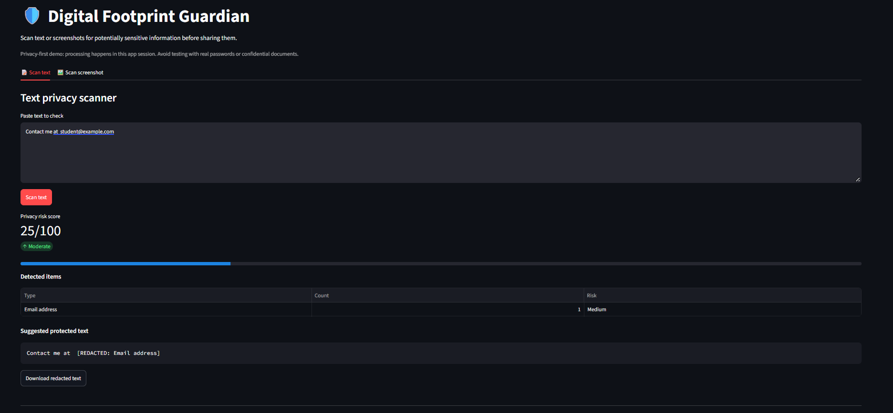

# 🛡️ Digital Footprint Guardian

A beginner-friendly privacy-scanning web app that checks text and screenshots for common sensitive information before sharing.

## Features

- Detects email addresses, phone-number-like strings, API-token patterns, password-like assignments, and IPv4 addresses in text.
- Calculates a simple, explainable privacy risk score.
- Creates a redacted text copy.
- Uses OCR to scan screenshots and covers lines containing supported patterns.
- Runs locally with Streamlit; uploaded images are not sent to a separate project server by this code.

## Project structure

```text
digital_footprint_guardian/
├── app.py
├── privacy_scanner.py
├── image_analyzer.py
├── requirements.txt
├── README.md
└── tests/
    └── test_privacy_scanner.py
```

## Requirements

- Python 3.10 or newer
- Tesseract OCR application for screenshot scanning
- Python packages listed in `requirements.txt`

Text scanning works without Tesseract. Screenshot OCR requires both `pytesseract` and the separate Tesseract application.

### Install Tesseract

- **Windows:** Install Tesseract OCR from the official UB Mannheim installer page: https://github.com/UB-Mannheim/tesseract/wiki
- **Ubuntu/Debian:** `sudo apt install tesseract-ocr`
- **macOS (Homebrew):** `brew install tesseract`

After installation, open a new terminal. If Windows cannot find Tesseract, add its installation folder to PATH or configure `pytesseract.pytesseract.tesseract_cmd` in `image_analyzer.py`.

## Run locally

Open a terminal in this project folder and run:

```bash
python -m venv .venv
```

Activate the environment:

**Windows**
```bash
.venv\Scripts\activate
```

**macOS/Linux**
```bash
source .venv/bin/activate
```

Install packages and start the app:

```bash
pip install -r requirements.txt
streamlit run app.py
```

Streamlit will print a local URL, usually `http://localhost:8501`. Open it in your browser.

## Example text to test

Use fake sample data only:

```text
Contact: student@example.com
Phone: 9876543210
password = demoSecret123
API token: sk-abcdefghijklmnop
Server: 192.168.1.10
```

## How the risk score works

The scanner adds fixed points for each supported pattern, caps repeated matches, and caps the final score at 100. This is a transparent rule-based baseline, not a trained machine-learning model. You can improve it by collecting synthetic examples and evaluating a classifier in a future version.

## Important limitations

- Pattern matching can miss sensitive information or flag ordinary text incorrectly.
- OCR can fail on small, blurry, rotated, or stylized text.
- Screenshot redaction covers the whole OCR line containing a match, so review the image carefully before sharing.
- The app does not guarantee that a file is safe to publish.
- Do not use real passwords, API keys, or confidential screenshots while testing.

## Ideas for version 2

- Add a synthetic dataset and compare a scikit-learn classifier with the rule-based baseline.
- Add language support and configurable detection rules.
- Add a scan history that stores only counts, never raw sensitive text.
- Add unit tests and GitHub Actions.

## GitHub upload

1. Create a new repository on GitHub named `digital-footprint-guardian`.
2. Extract this project ZIP.
3. Open a terminal inside the extracted folder.
4. Run:

```bash
git init
git add .
git commit -m "Build Digital Footprint Guardian"
git branch -M main
git remote add origin https://github.com/YOUR-USERNAME/digital-footprint-guardian.git
git push -u origin main
```

Replace `YOUR-USERNAME` with your GitHub username. Never commit passwords, API keys, private files, or real personal data.


## Project Screenshot
! [Digital Footprint Guardian]
          

## Project Demo

[▶ Watch the Project Demo](https://youtu.be/13u02HrcP5Y)
